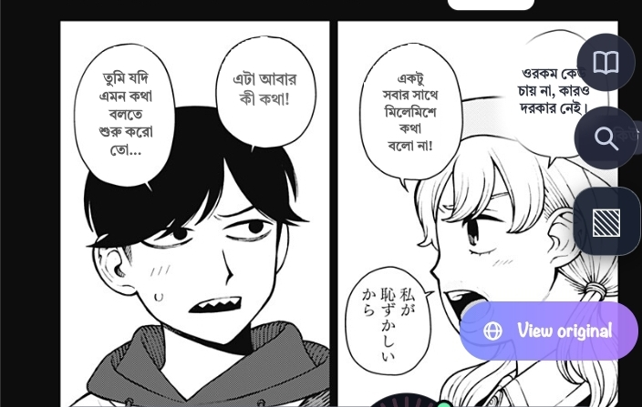
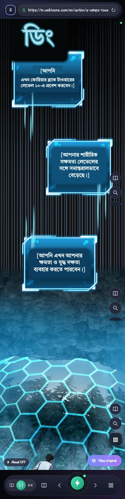
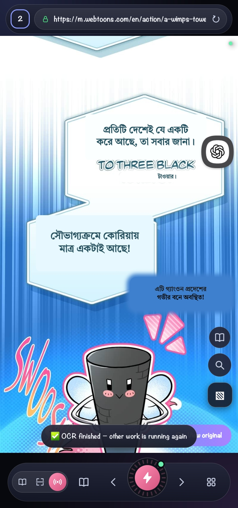
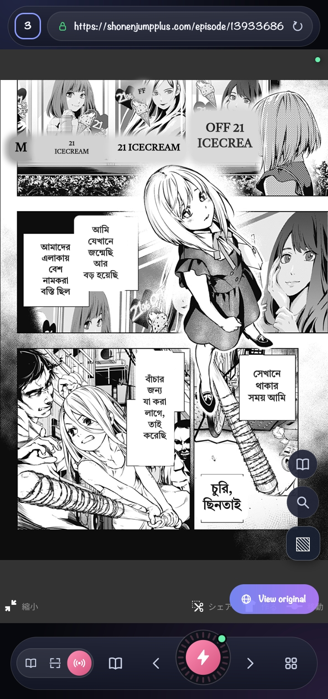
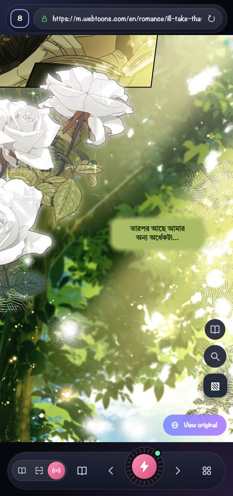
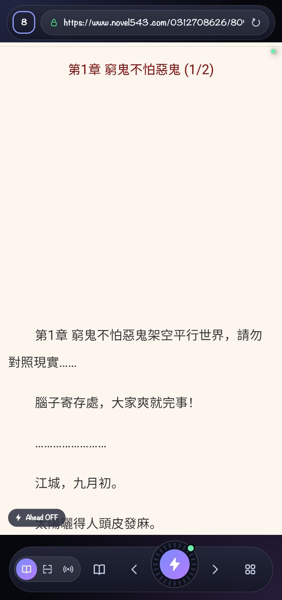
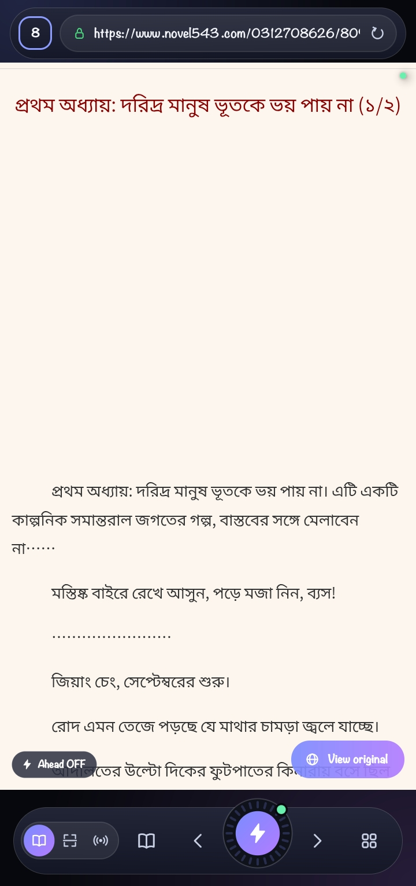
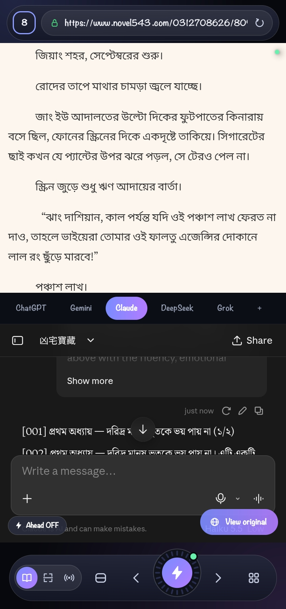
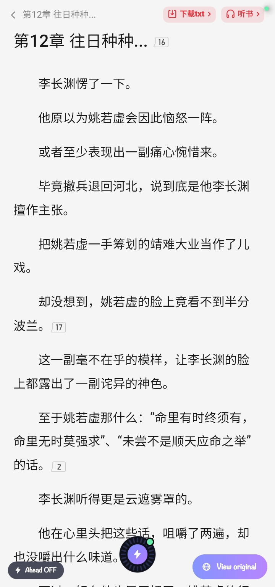
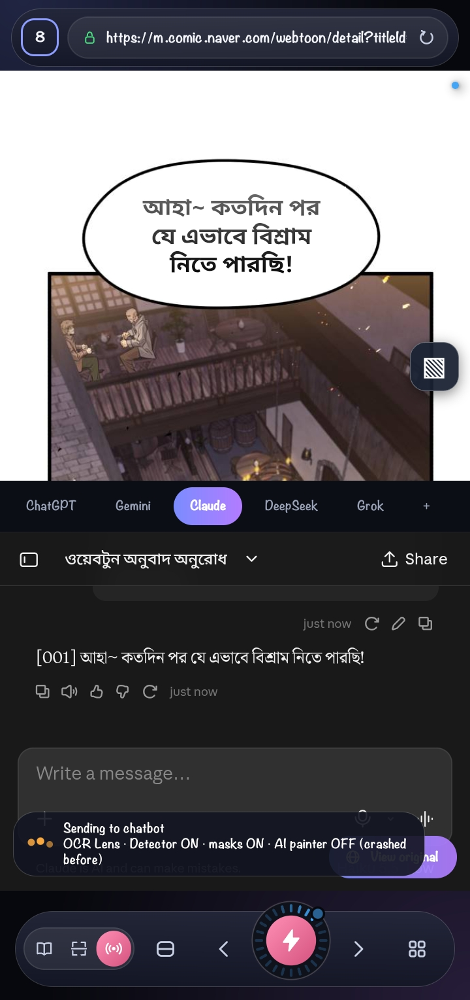

# ToonSensei — Novel, Manga & Webtoon Translator

**Read Beyond Languages.**

*Translate novels, manga & webtoons using your favorite AI websites.*

[English](README.md) · [বাংলা](README_bn.md)

---

## What is ToonSensei?

ToonSensei is an Android reading app that works as a middleman between the page you are reading and the AI chatbot you choose. For web novels, it can extract chapter text from the page and send it to the chatbot for translation. For image-based webtoons and manga, it can use OCR to recognize text in the images, send that text through the translation workflow, and place the translated result back over the original page. The idea is simple: keep reading on the page you already use while ToonSensei handles the steps between the source text and its translation.

ToonSensei uses a chatbot's web interface rather than shipping its own general-purpose translation model. It does not host or redistribute the website's original chapters. Some features can save translated text locally, such as the translation library.

## What it can do

### Web novels
- Extract chapter text from a reader page when the site's structure allows it.
- Send the extracted text to the configured chatbot and insert the translation back into the reading workflow.
- Support next/previous chapter navigation and optional automatic extraction/translation.
- Keep translated chapters in a local library, with options to view and export them as TXT.
- Use a glossary and editable prompts to help keep names and terminology consistent.

### Webtoons and manga
- Recognize text inside chapter images with OCR.
- Show translated text over the original lettering instead of requiring a separate translated-image reader.
- Offer chapter-wide scanning, real-time scanning while reading, and manual OCR for a selected area or missed text.
- Keep the original view available so readers can compare the source and translation.
- Use bubble/layout analysis to place translated lines near their source positions.

### Reading tools
- Read websites inside the app's WebView.
- Use reader and chatbot views as supported by the current interface.
- Keep bookmarks and browsing history.
- Adjust translation prompts and target-language settings.

The results and available controls depend on the website, the selected mode, and the configured chatbot. Compatibility is not guaranteed for every website.

## The four main modes

### 1. Novel
Made for text-based web novels, including Chinese, Korean, and Japanese novels. ToonSensei extracts chapter text from the reader page and sends it to the chatbot you choose so you can read the story in your target language. **Auto Ahead** can prepare the next **7 chapters** in advance, where the site and settings support it.

### 2. Scanning
Scans a chapter's image panels in one pass and prepares the chapter for translated reading, rather than making you handle each panel separately. In the developer's tests, a Fast Scan run processed **64 panels in 52 seconds**; chapter size, phone resources, and other conditions affect the time.

### 3. Real-Time
Provides fast, automatic translation while you read. It detects text regions and their positions, uses bubble/layout analysis to help associate text with the right area, and places translated text over the original page. Detection and placement can still be affected by difficult lettering or page layouts.

### 4. Manual Lite
Designed for phones with limited RAM. Like Real-Time, it works with the visible screen, but **does not automatically start translating every time a new screen appears**. Instead, tap the button to send the bubble text currently visible on screen—whether there is one bubble or several. Avoiding continuous automatic work can reduce memory and battery pressure; the actual benefit depends on the device and usage.

## Screenshots

These screenshots show ToonSensei in use for text-based novels and image-based webtoons/manga.

### Novel reading and translation

  
  

  
  

  

### Webtoon and manga translation

  
  

  
  

  
  

  
  

## How it works

**For a web novel:** ToonSensei reads the chapter text available from the reader page, sends it to the selected chatbot, and then places or saves the translated result.

**For an image-based chapter:** ToonSensei reads the page images or visible screen area, runs OCR to identify text and its position, sends the extracted text through the translation workflow, and renders the translated text over the corresponding areas. OCR and translation are separate steps: recognizing the source text correctly does not automatically guarantee a perfect translation.

ToonSensei does not require a ToonSensei-specific AI API key for its web-chatbot workflow. You use the chatbot website configured in the app; that service's own sign-in requirements, access rules, and usage limits still apply.

## OCR languages and reader-reported results

The current code supports ML Kit OCR recognizers for **Latin, Chinese, Japanese, and Korean** scripts. Google ML Kit is the default OCR engine in the current branch. Google Lens OCR is also available as an optional engine. OCR script selection can depend on the selected setting and the page being read.

From my experience as an everyday reader, ordinary **Chinese and Korean text** are recognized at **around 90%** in typical cases, while ordinary Japanese manga text is around **80–90%**. These are personal, informal estimates—not measured benchmarks, controlled studies, or guarantees for every page. They describe regular text, not every kind of lettering. Small or blurry text, unusual fonts, stylized sound effects, complex image layouts, and other difficult cases can reduce results.

The remaining mistakes are not all the same kind of problem. Some begin with OCR missing or misreading the source text; translation quality can also depend on the selected chatbot, target language, prompt, and surrounding story context. A stronger prompt and better context can help the translation, but they cannot recover source text that OCR never read correctly.

## My personal AI chatbot ratings

These are my own reader-side impressions of translation quality and speed, not a controlled benchmark. Results depend on the chapter, language pair, prompt, model version, and service conditions.

| Chatbot / model | My rating | Speed in my use | Notes |
|---|---:|---|---|
| ChatGPT | 7/10 | Fast | A useful general option. |
| Gemini | 6/10 | Fast to medium | Speed varies in my experience. |
| Claude Haiku 5.5 | 9.5/10 | Fast | My first choice to try for a balance of translation quality and speed. [Official model page](https://www.anthropic.com/claude-haiku-5-5). |
| DeepSeek | 8.5/10 | Fast | A strong prompt and enough story context matter; otherwise, it can lose context. |
| Grok | 10/10 for adult/NSFW material | Medium to slow | In my experience, it handles this material well, but it sometimes appears to spend time thinking even on simple messages. |

**My recommendation:** sign in to Claude and try **Haiku 5.5** first. These ratings are subjective, can change as chatbot models change, and should not be treated as a guarantee for every reader or chapter.

## Performance and testing

On the developer's own low-budget Samsung SM-A136B phone with 3 GB RAM, some chapter translation jobs have taken roughly **50 seconds** in testing. One recorded Fast Scan test processed **64 panels in 52 seconds**. These are observations from specific tests, not a universal speed claim or a guarantee that every chapter will finish within that time.

Actual speed can vary with the phone, available memory, network, number and quality of images, website behavior, and chatbot response time.

**This project has not yet undergone large-scale testing** across a wide range of phones, websites, chapters, and reading conditions. Community testing is needed to find compatibility issues, OCR mistakes, layout bugs, and performance problems. Feedback and bug reports are welcome.

## Technical overview

- **Platform:** Android, Kotlin, minSdk 24 (Android 7.0 or later); Java/Kotlin target 17.
- **Page integration:** Android WebView with a JavaScript bridge.
- **OCR:** ML Kit recognizers for Latin, Chinese, Japanese, and Korean; optional Google Lens OCR.
- **Text placement:** OCR text blocks and their geometry, bubble/layout analysis, and an HTML/JavaScript overlay.
- **Optional image cleanup:** ONNX Runtime supports optional detection/inpainting components. The LaMa inpainting model is downloaded separately rather than bundled in the APK; whether it can be used depends on device resources and model availability.
- **Translation:** The chatbot web interface configured by the reader; translation behavior depends on that service and the prompt.

These are implementation details, not a claim that every optional model is installed or enabled on every device.

## Community testing

This project is still being improved, and broad real-world validation is not complete. If you try it, reports that include the phone model, website, mode, source language, and a short description of what went wrong are especially helpful. Please avoid sharing private account information or session details in bug reports.

## License

The original project source code is licensed under the [MIT License](LICENSE). Third-party libraries, SDKs, models, fonts, and online services retain their own licenses and terms. The MIT License does not grant rights to third-party content or material the project does not own.

## Credits

Built by Ashraf Ali 🇧🇩

Special thanks to the open-source community and everyone whose work helped make this project possible.

---

ToonSensei is intended as a reading aid. Please respect the terms of the websites you use and the authors who create the original work.
